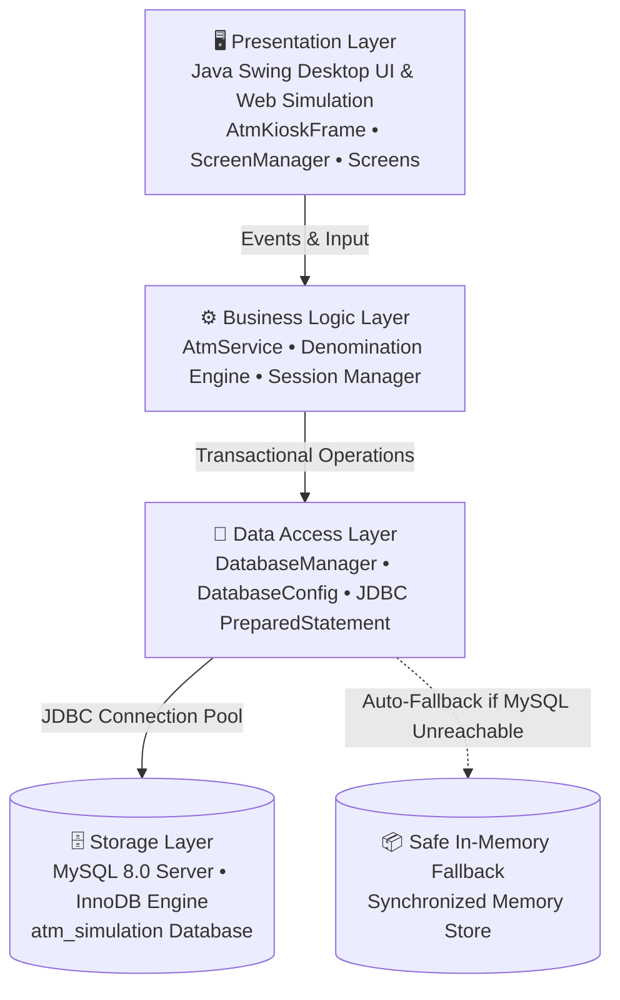
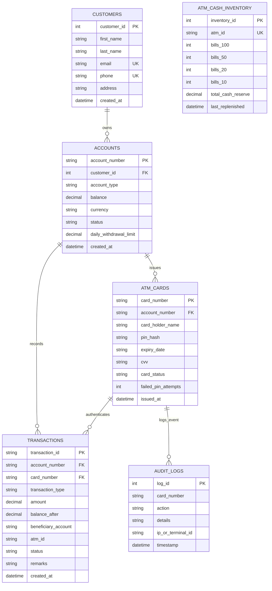

# 🏧 Apex National Bank — ATM Transaction Simulation System

[](https://www.oracle.com/java/)
[](https://www.mysql.com/)
[](https://dev.mysql.com/downloads/connector/j/)
[](https://docs.oracle.com/en/java/javase/21/docs/api/java.desktop/javax/swing/package-summary.html)
[](https://en.wikipedia.org/wiki/ACID)
[](https://csrc.nist.gov/publications/detail/fips/180/4/final)

A production-grade, full-stack **ATM Transaction Simulation System** developed natively in **Java SE 21** and backed by a persistent **MySQL 8.0** relational database. 

The system couples a realistic physical ATM kiosk desktop interface with strict banking-grade ACID transaction guarantees, cryptographic SHA-256 PIN authentication, automated banknote denomination optimization, intra-bank electronic wire transfers, cash hopper deposits, and comprehensive audit ledger tracking.

---

## 📑 Table of Contents
- [System Architecture](#-system-architecture)
- [Key Features](#-key-features)
- [Relational Database Design](#-relational-database-design)
- [ACID Transaction Guarantees](#-acid-transaction-guarantees)
- [Security & Authentication](#-security--authentication)
- [Windows Setup & Installation](#-windows-setup--installation)
- [Configuration & Credentials](#-configuration--credentials)
- [How to Run](#-how-to-run)
- [Automated Integration Testing](#-automated-integration-testing)
- [Demo Account Profiles](#-demo-account-profiles)
- [Project Directory Layout](#-project-directory-layout)

---

## 🏛 System Architecture

The application adheres to clean separation of concerns across four decoupled architectural layers:



1. **Presentation Layer (`com.atm.ui`)**: Dark-themed ATM terminal enclosure featuring physical touchscreen bezel, metallic numeric pinpad, EMV chip card reader, banknote dispenser, and receipt printer.
2. **Business Logic Layer (`com.atm.service`)**: Enforces daily withdrawal limits, greedy banknote denomination allocation ($100, $50, $20, $10), 3-strike card lockout policy, and session management.
3. **Data Access Layer (`com.atm.db`)**: JDBC persistence layer utilizing `PreparedStatement`, transactional commit/rollback workflows, and connection health diagnostics.
4. **Relational Database (`MySQL 8.0`)**: 3NF normalized schema (`atm_simulation`) with InnoDB engine, foreign key cascades, and check constraints.

---

## ✨ Key Features

### 1. Realistic Hardware Kiosk Interface
- **Touchscreen Navigation**: 8 major banking operations with visual cards and shortcut key routing.
- **Physical Pinpad Simulation**: Functional on-screen and keyboard-driven numeric pad (`0–9`, `Cancel [C]`, `Enter [↵]`).
- **Dynamic Peripheral Console**: Active hardware status indicators for Card Reader, Receipt Printer, and Cash Vault.
- **Thermal Receipt Slips**: Realistic formatted transaction receipts with unique audit reference hashes and barcodes.

### 2. Comprehensive Core Banking Transactions
- **Fast Cash Dispense**: Instant 1-touch preset cash disbursements ($20, $40, $60, $100, $200, $500).
- **Custom Cash Withdrawal**: Greedy note distribution algorithm calculating the exact combination of $100, $50, $20, and $10 bills while respecting available vault inventory.
- **Banknote Deposit Hopper**: Accepts multi-denomination bill deposits with live totalization and atomic vault replenishment.
- **Intra-Bank Fund Transfers**: Real-time electronic funds transfers to any valid beneficiary account with atomic debit and credit execution.
- **Balance Inquiry**: Instant readout of cleared available funds, account category, and daily limit allowances.
- **Mini Statement**: Chronological transaction history displaying amounts, post-transaction balances, timestamps, and status codes.
- **PIN Management**: Secure in-terminal PIN modification with validation and confirmation matching.

---

## 🗄 Relational Database Design

The `atm_simulation` database is normalized to **Third Normal Form (3NF)** with zero transitive dependencies.



### Table Specifications
- **`customers`**: Primary customer profile records (Name, Email, Phone, Address).
- **`accounts`**: Bank deposit accounts linked to customers with balance, currency, type, and daily limit invariants (`balance >= 0.00`).
- **`atm_cards`**: Physical EMV cards linked to accounts, storing salted SHA-256 PIN digests, failed attempt counters, and card status (`ACTIVE`, `BLOCKED`, `EXPIRED`).
- **`transactions`**: Double-entry financial audit journal recording withdrawals, deposits, transfers, and status remarks.
- **`atm_cash_inventory`**: Real-time hardware hopper counts for $100, $50, $20, and $10 bills, ensuring the machine never dispenses currency it does not physically possess.
- **`audit_logs`**: Security telemetry capturing card insertions, authentication outcomes, and administrative events.

---

## 🛡 ACID Transaction Guarantees

All critical financial operations are executed within explicit JDBC transactions (`conn.setAutoCommit(false)`):

| Operation | Atomic Steps Enclosed in Transaction | Rollback Trigger |
| :--- | :--- | :--- |
| **Fund Transfer** | 1. Debit sender account (`balance = balance - ? WHERE balance >= ?`)<br/>2. Query updated sender balance<br/>3. Credit recipient account (`balance = balance + ?`)<br/>4. Query updated recipient balance<br/>5. Insert `TRANSFER_OUT` transaction<br/>6. Insert `TRANSFER_IN` transaction<br/>7. Insert audit log | Insufficient sender balance, inactive recipient account, or connection interruption. |
| **Cash Withdrawal** | 1. Debit account balance<br/>2. Query updated balance<br/>3. Decrement specific ATM hopper bill counts (`bills_xxx >= ?`)<br/>4. Insert `WITHDRAWAL` transaction<br/>5. Insert audit log | Insufficient account funds, machine bill depletion, or database exception. |
| **Cash Deposit** | 1. Credit account balance<br/>2. Query updated balance<br/>3. Increment ATM hopper bill counts<br/>4. Insert `DEPOSIT` transaction<br/>5. Insert audit log | Account closed/frozen or database constraint violation. |

---

## 🔒 Security & Authentication

- **One-Way SHA-256 Hashing**: Card PINs are never stored in plaintext. Authentication hashes the user's input and compares it against `pin_hash`.
- **Automatic 3-Strike Lockout**: Three consecutive incorrect PIN attempts immediately update the card status to `BLOCKED` in the MySQL database, rejecting further attempts until unlocked by bank staff.
- **Pessimistic Balance Verification**: Updates use conditional SQL clauses (`WHERE balance >= ?`) preventing race conditions and negative balances.
- **Password Shielding**: Database passwords are never printed in console logs, exception traces, or UI dialogs.
- **SQL Injection Prevention**: 100% of dynamic queries use parameterized `PreparedStatement` instances.

---

## 🛠 Windows Setup & Installation

### Prerequisites
- **Java SE 21** or later (`java -version`, `javac -version`)
- **MySQL Server 8.0** running on `localhost:3306`
- **MySQL Workbench** or MySQL CLI

### Step 1: Verify MySQL Service
Ensure the local MySQL Windows service is active:
```powershell
Get-Service MySQL80
```
If stopped, start it with administrator privileges:
```powershell
Start-Service MySQL80
```

### Step 2: Initialize Database Schema and Demo Data
Open **MySQL Workbench** and execute the provided scripts:

1. **Create the Database and Tables**:
   Execute [`database/schema.sql`](file:///database/schema.sql):
   ```powershell
   Get-Content -Raw "database/schema.sql" | & "C:\Program Files\MySQL\MySQL Server 8.0\bin\mysql.exe" -u root -p atm_simulation
   ```
2. **Populate Idempotent Seed Data**:
   Execute [`database/seed_data.sql`](file:///database/seed_data.sql):
   ```powershell
   Get-Content -Raw "database/seed_data.sql" | & "C:\Program Files\MySQL\MySQL Server 8.0\bin\mysql.exe" -u root -p atm_simulation
   ```

---

## 🔑 Configuration & Credentials

The application uses a secure configuration hierarchy to prevent committing real credentials to Git:

### Option A: Environment Variable (Recommended)
Set the `ATM_DB_PASSWORD` variable in your terminal before launching:
```powershell
$env:ATM_DB_PASSWORD = "your_mysql_password"
```

To persist the variable across Windows reboots:
```powershell
[System.Environment]::SetEnvironmentVariable('ATM_DB_PASSWORD', 'your_mysql_password', 'User')
```

### Option B: Local Properties File
Copy [`database.properties.example`](file:///database.properties.example) to `database.properties` in the project root:
```properties
db.host=localhost
db.port=3306
db.name=atm_simulation
db.user=root
db.password=your_mysql_password
```
*(Note: `database.properties` is strictly ignored by `.gitignore` and will never be committed to Git).*

---

## 🚀 How to Run

### 1. Launch Interactive Desktop ATM Kiosk
Double-click [`run.bat`](file:///run.bat) or execute via terminal:
```powershell
$env:ATM_DB_PASSWORD = "your_mysql_password"
.\run.bat
```

The system verifies connectivity on boot and prints diagnostic status:
```
=================================================
  APEX BANK ATM TRANSACTION SIMULATION SYSTEM   
  [STORAGE STATUS] Connected to live MySQL database
  [TARGET] jdbc:mysql://localhost:3306/atm_simulation
  [USER]   root
=================================================
```

### 2. Manual Command-Line Compilation & Launch
```powershell
javac -encoding UTF-8 -cp "lib/*;src" -d bin src\com\atm\model\*.java src\com\atm\db\*.java src\com\atm\service\*.java src\com\atm\ui\*.java src\com\atm\ui\screens\*.java src\com\atm\pdf\*.java src\com\atm\Main.java
java -Dfile.encoding=UTF-8 -cp "bin;lib/*" com.atm.Main
```

### 3. Generate Official Submission PDF Report
Double-click [`generate_pdf.bat`](file:///generate_pdf.bat) or run:
```powershell
java -Dfile.encoding=UTF-8 -cp "bin;lib/*" com.atm.Main --all-pdfs
```

---

## 🧪 Automated Integration Testing

A standalone test suite ([`DatabaseIntegrationTest.java`](file:///src/com/atm/test/DatabaseIntegrationTest.java)) validates end-to-end functionality directly against the live MySQL database:

```powershell
$env:ATM_DB_PASSWORD = "your_mysql_password"
java "-Dfile.encoding=UTF-8" -cp "bin;lib/*" com.atm.test.DatabaseIntegrationTest
```

### Live Test Execution Output:
```
=================================================
  RUNNING APEX BANK ATM MYSQL INTEGRATION TESTS  
=================================================
[TEST 1] Testing MySQL Connection... PASSED (Connection successful to jdbc:mysql://localhost:3306/atm_simulation)
[TEST 2] Testing Demo Card Authentication (Alexander Vance)... PASSED
[TEST 3] Testing Balance Inquiry... PASSED (Balance: $5,410.50)
[TEST 4] Testing Cash Withdrawal ($60)... PASSED (Dispensed notes: {50=1, 10=1}, New Balance: $5,350.50)
[TEST 5] Testing Cash Deposit (1x$100, 1x$50 = $150)... PASSED (New Balance: $5,500.50)
[TEST 6] Testing Fund Transfer ($100 to ACC-1001-8843)... PASSED (Sender: $5,400.50, Recipient: $18,950.00)
[TEST 7] Testing Transaction Rollback on Overdraft ($999,999.00)... PASSED (Atomic rollback verified; balances unchanged)
[TEST 8] Testing Mini Statement retrieval... PASSED (Retrieved 5 latest transactions from MySQL)
[TEST 9] Testing PIN Change (1234 -> 7890 -> 1234)... PASSED (Persistent SHA-256 PIN hash update confirmed in MySQL)
[TEST 10] Testing Persistence Verification (Fresh connection query)... PASSED (Balance $5,400.50 persisted in MySQL database)
=================================================
  SUMMARY: 10 / 10 TESTS PASSED
=================================================
All MySQL JDBC database integration tests completed successfully!
```

---

## 💳 Demo Account Profiles

| Cardholder Name | Card Number | PIN | Linked Account | Account Type | Balance | Card Status |
| :--- | :--- | :--- | :--- | :--- | :--- | :--- |
| **Alexander Vance** | `4532 1100 2233 4455` | `1234` | `ACC-1001-8842` | Savings | **$5,420.50** | `ACTIVE` |
| **Sophia Williams** | `5412 7500 8899 1234` | `4321` | `ACC-2002-4419` | Checking | **$3,150.00** | `ACTIVE` |
| **David Miller** | `4000 1234 5678 9010` | `9999` | `ACC-3003-9120` | Savings | **$820.00** | `BLOCKED` *(3-Strike Demo)* |

---

## 📁 Project Directory Layout

```
atm-transaction-system/
├── database/                                 # Database Design & DDL Scripts
│   ├── schema.sql                            # MySQL 8.0 Relational DDL Schema
│   ├── seed_data.sql                         # Idempotent Seed Records (INSERT IGNORE)
│   ├── queries.sql                           # Verification & Operational SQL Queries
│   └── DATABASE_DESIGN.md                    # Data Dictionary, ERD & 3NF Proof
├── lib/                                      # Third-Party Dependencies
│   └── mysql-connector-j.jar                 # Official MySQL Connector/J JDBC Driver
├── screenshots/                              # Visual Documentation Screenshots
│   ├── 01_Welcome_Screen.png
│   ├── 02_PIN_Entry_Screen.png
│   ├── 03_Main_Menu_Screen.png
│   ├── 04_Balance_Inquiry_Screen.png
│   ├── 05_Fast_Cash_Screen.png
│   ├── 06_Cash_Withdrawal_Screen.png
│   ├── 07_Cash_Deposit_Screen.png
│   ├── 08_Fund_Transfer_Screen.png
│   ├── 09_Mini_Statement_Screen.png
│   ├── 10_PIN_Change_Screen.png
│   └── 11_Thermal_Receipt_Slip.png
├── src/com/atm/
│   ├── Main.java                             # Application Entry Point & CLI Dispatcher
│   ├── db/                                   # Data Layer
│   │   ├── DatabaseConfig.java               # Dynamic JDBC Configuration & Credential Shield
│   │   └── DatabaseManager.java              # JDBC Persistence & ACID Transaction Engine
│   ├── model/                                # Relational Domain Models
│   │   ├── Account.java
│   │   ├── AtmCard.java
│   │   ├── AuditLog.java
│   │   ├── CashInventory.java
│   │   ├── Customer.java
│   │   └── Transaction.java
│   ├── service/                              # Business Logic
│   │   ├── AtmService.java                   # Banking Operations Engine
│   │   └── AtmSession.java                   # Active User Session State
│   ├── test/                                 # Automated Test Suite
│   │   └── DatabaseIntegrationTest.java      # 10-Case MySQL Integration Test
│   └── ui/                                   # Presentation Layer (Swing)
│       ├── AtmKioskFrame.java                # Outer Terminal Chassis & Keypad Bezel
│       ├── ModernButton.java                 # Custom Rounded Aesthetic Buttons
│       ├── ScreenManager.java                # State Navigator & Keypad Router
│       ├── UITheme.java                      # Design Tokens, Palette & Fonts
│       └── screens/                          # Terminal Screens
│           ├── BalanceScreen.java
│           ├── DepositScreen.java
│           ├── FastCashScreen.java
│           ├── MainMenuScreen.java
│           ├── MiniStatementScreen.java
│           ├── PinChangeScreen.java
│           ├── PinEntryScreen.java
│           ├── ReceiptPopup.java
│           ├── TransferScreen.java
│           └── WelcomeScreen.java
├── database.properties.example               # Template Properties Configuration
├── generate_backend_pdf.bat                  # Batch Script: Backend Report Generator
├── generate_pdf.bat                          # Batch Script: Frontend Report Generator
├── index.html                                # Standalone Web ATM Kiosk Preview
├── README.md                                 # Project Documentation
└── run.bat                                   # Double-Click Windows Desktop Launcher
```

---

## 📄 License
This project is open-source and available under the [MIT License](LICENSE).
